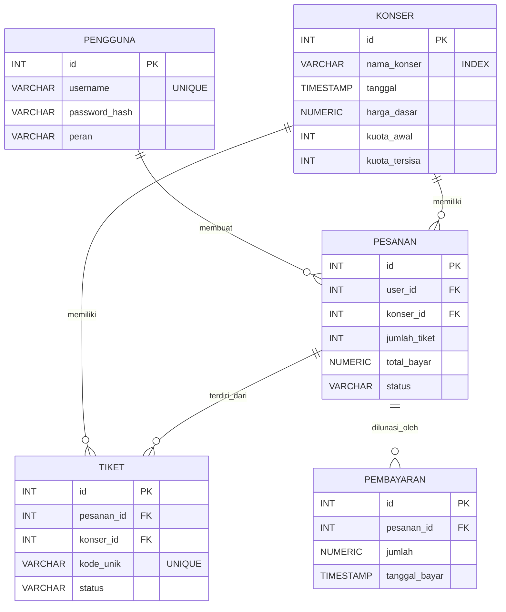

# ERD & Spesifikasi Use Case

## 1. Use Case Diagram

```mermaid
usecaseDiagram
    actor Pembeli
    actor Petugas

    usecase "Login" as UC1
    usecase "Melihat Konser Tersedia" as UC2
    usecase "Buat Pesanan Tiket (Maks 4)" as UC3
    usecase "Bayar Pesanan" as UC4
    usecase "Melihat Riwayat Pesanan" as UC5

    Pembeli --> UC1
    Pembeli --> UC2
    Pembeli --> UC3
    Pembeli --> UC4

    Petugas --> UC1
    Petugas --> UC2
    Petugas --> UC5
```

## 2. Entity Relationship Diagram (ERD)


